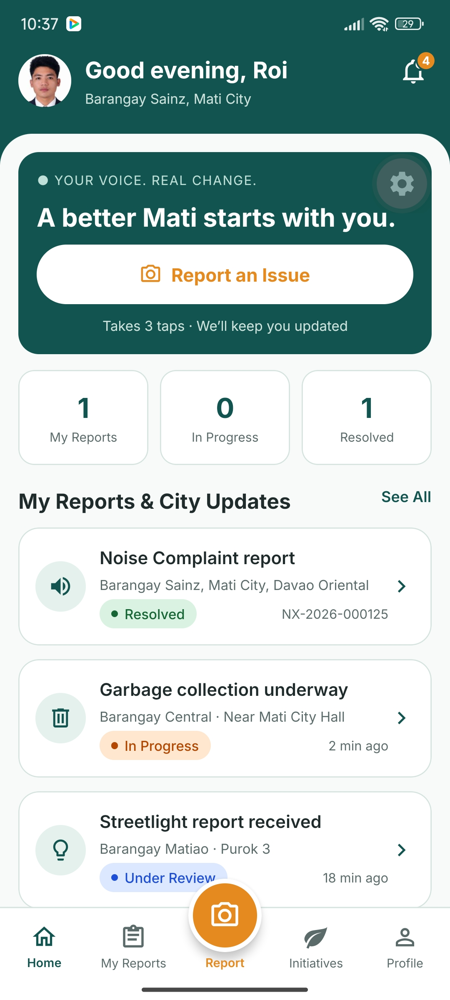
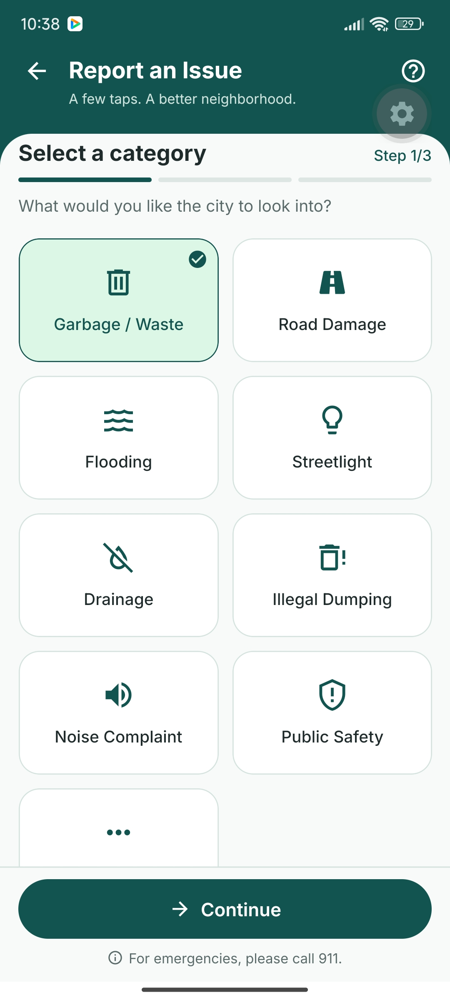
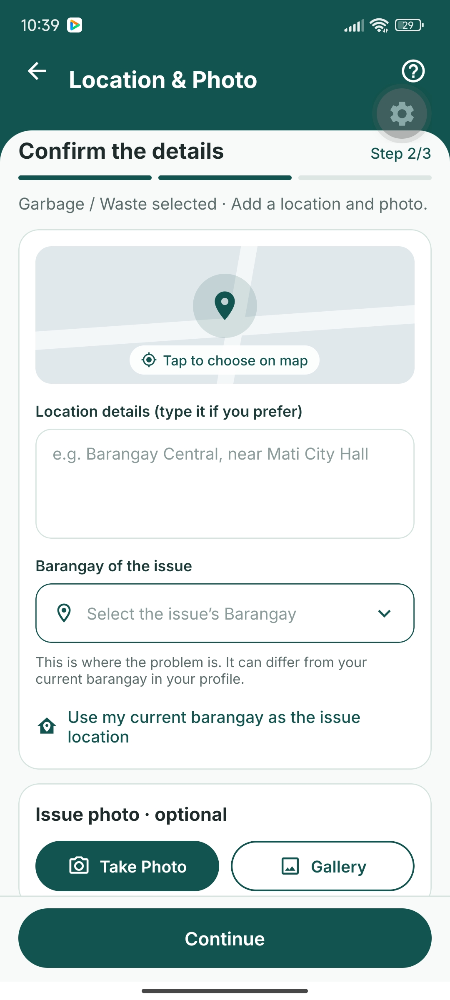
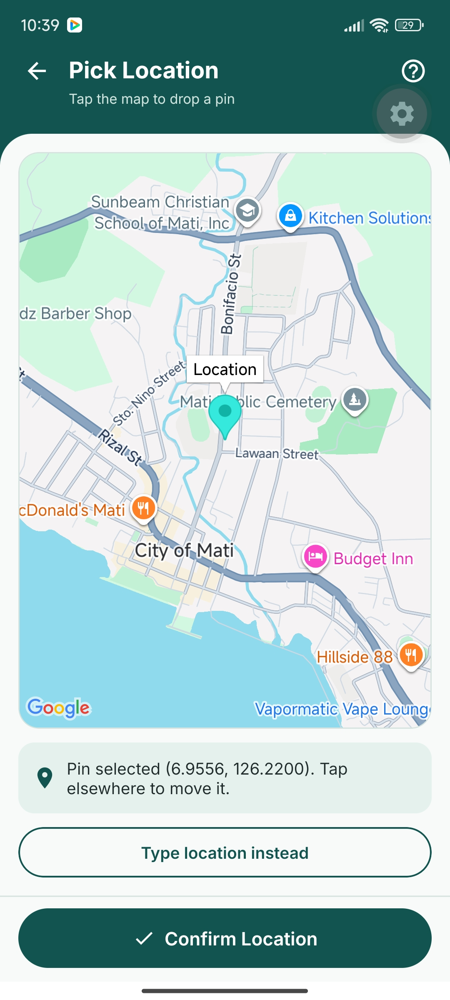
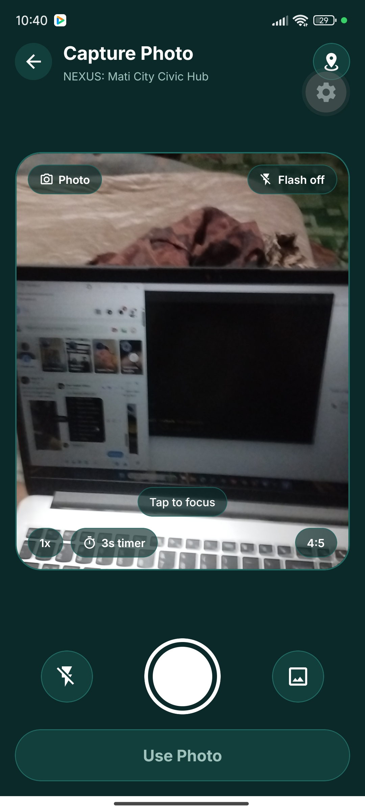
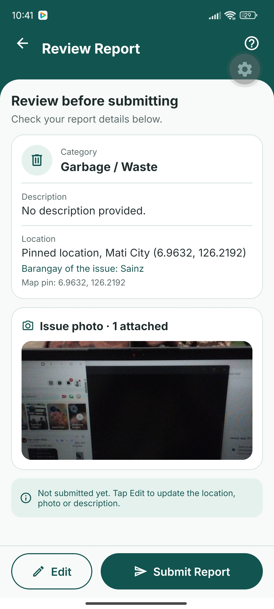
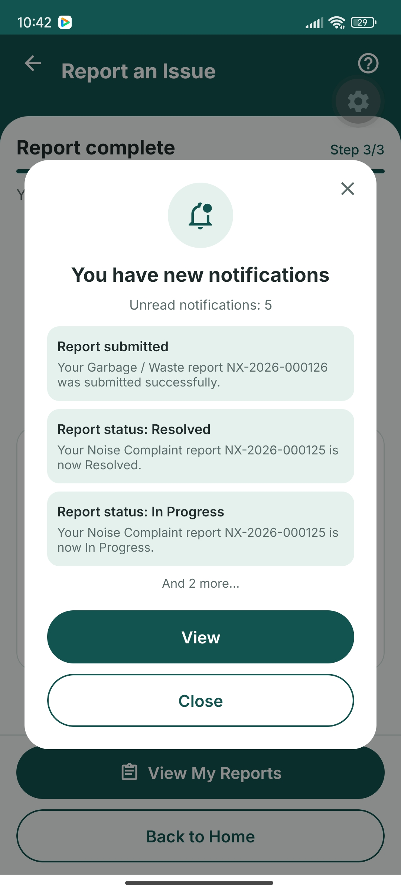
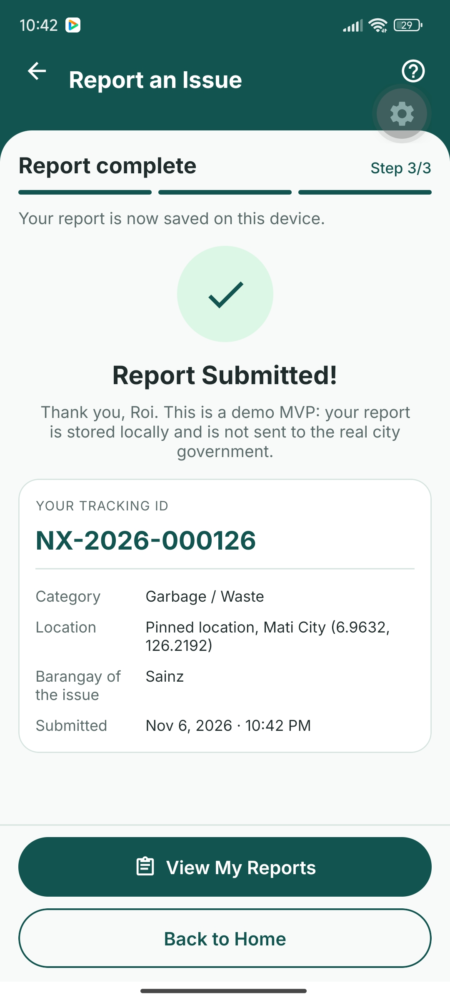
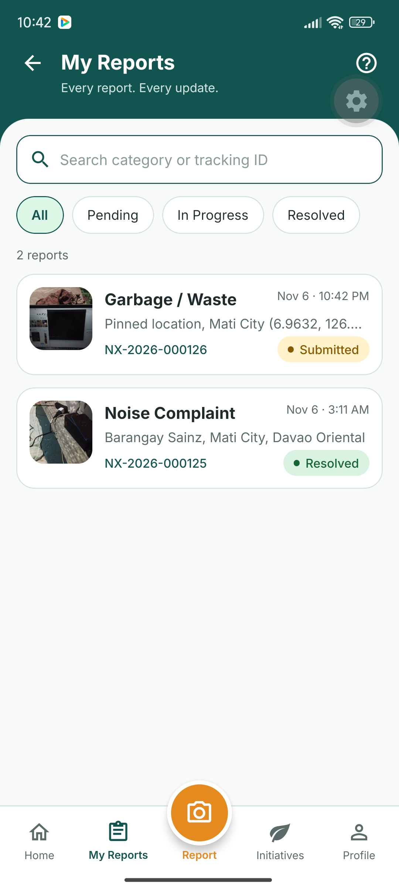
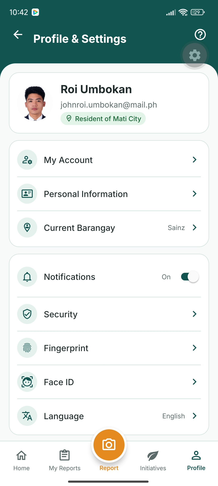

# NEXUS – Mati City Civic Hub
## Week 3: Mobile Application Development

### Project Overview
NEXUS is a mobile application designed to help residents of Mati City report community issues and concerns. It aims to support safer, cleaner, and more sustainable communities in alignment with **Sustainable Development Goal 11: Sustainable Cities and Communities**.

### Technologies Used
- Expo SDK 58
- React Native 0.88
- React 19.3
- TypeScript
- Expo Router
- SQLite
- expo-file-system
- expo-camera
- expo-image-picker
- react-native-maps
- React Native Reanimated
- Gesture Handler
- React Native Screens
- Safe Area Context
- expo-linear-gradient
- Inter Font
- Vector Icons

### Implemented Features
1. User Login and Registration
2. Home Dashboard
3. Community Issue Reporting
4. Report Category Selection
5. Barangay Selection
6. Map Location Pinning
7. Camera Integration
8. Gallery Image Selection
9. Report Review
10. Report Submission
11. My Reports
12. Report Details and Comments
13. Notifications
14. User Profile and Settings
15. Language Selection

### Application Screenshots

#### 1. Home Dashboard

#### 2. Report Category

#### 3. Location and Photo

#### 4. Map Pinning

#### 5. Camera Screen

#### 6. Review Report

#### 7. Notification Popup

#### 8. Report Success

#### 9. My Reports

#### 10. Profile and Settings

### Data Storage and Application Scope
NEXUS uses local SQLite storage for application data. The current implementation is a functional prototype and does not connect to an actual Mati City government server or provide live government report tracking.

### AI Disclosure
AI tools were used to assist with development guidance, troubleshooting, and code implementation. Refer to the repository's `AI_DISCLOSURE_LOG.md` for the detailed disclosure.

### Development Status
**Week 3 – Mobile Application Development: Completed**
